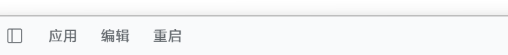

# dsh-desktop-tools

把桌面版 DSH 的两个小开关合进一个插件：

- **标题栏「重启」**：不占侧边栏，按钮在桌面窗口标题栏「应用 / 编辑」右边，点一下确认后整个应用自动重启。
- **设置 → 通用「开机自启」**：一行开关，控制登录 Windows 时是否自动启动 DSH。



这两个功能原来分别是两个本地插件（`dsh-sidebar-restart` 的标题栏改造版 + `dsh-autostart-local`），
现在合成一个包，新电脑装一次就都有。

## 它做什么

### 重启

DSH 的 Host 是 Electron 主进程的普通 Node 子进程，不能自己调 `app.relaunch()`。所以重启由一个
**脱离进程树的 helper** 完成：

1. Host 先回 `202`，让浏览器拿到响应；
2. helper 按 PID 杀掉 Electron 主进程与 Host（Windows 用 `taskkill /pid <pid> /f`，不带 `/t`，否则会把 helper 自己带走）；
3. 轮询确认两个 PID 真的消失——不这样做，新进程会和单实例锁撞上，被降级成「聚焦已有窗口」的空操作；
4. 清掉 `ELECTRON_RUN_AS_NODE`，重新拉起应用。

页面的按钮在 POST 之后轮询 `/api/dsh-desktop-tools/status`，看到 `bootId` 变了就自动刷新页面，
回到原会话。刚装上的插件 bundle 因此才真正加载。

### 开机自启

只动一个**用户级**注册表值，不需要管理员权限：

```
HKCU\Software\Microsoft\Windows\CurrentVersion\Run  →  DeepSeek Harness = "<当前桌面版 exe>"
```

- exe 路径取 Host 的 `process.execPath`，并且只在它旁边存在 `resources/app.asar`（确认是桌面版）时才写，
  避免把 `node.exe` 写进启动项。
- 旧插件遗留的 `DSH NEXT` 值会被识别（开关显示真实状态），下次打开开关时自动迁移并删除旧值。
- 非 Windows 平台这一行显示「当前环境无法管理 Windows 启动项」，不会报错。

## 安装（新电脑）

前提：Windows + DSH 桌面版。

**方式 A：应用内安装（推荐）**

1. 侧栏「插件」→ 右上「添加插件」→「安装第三方插件」；
2. 粘贴仓库地址：

   ```
   https://github.com/momiji42/dsh-desktop-tools
   ```

3. 按提示安装。如果提示需要重启：手动退出应用再打开一次（或点已有旧插件的重启按钮）。
   载入后标题栏出现「重启」，设置 → 通用 里出现「开机自启」。

**方式 B：命令行**

```sh
dsh plugin --profile desktop add github:momiji42/dsh-desktop-tools
```

**方式 C：本地目录**

把仓库 clone 到任意位置，在「添加插件」对话框里填这个目录的绝对路径。

> 第一次装完必须有**一次完整的应用重启**（进程重启，不是 Ctrl+R）客户端按钮才会出现；
> 之后用它自己的「重启」按钮就够了。

## 兼容性

- 标题栏按钮依赖桌面 preload 挂出来的 `[data-windows-menu]` 影子 DOM 菜单栏；官方桌面版
  0.2.1-rc.5（Windows）上验证通过。换成没有这个结构的版本时按钮不显示，其它功能不受影响。
- 「重启」只在桌面版可用；`dsh web` 下没有这个入口（也没有标题栏）。
- 「开机自启」只在 Windows 可用。

## 结构

```
index.js            Host 半侧：三条路由（status / restart / autostart）+ 守卫 + helper 拉起
lib/helper.js       脱离进程树的重启 helper 源码（字符串生成，便于断言）
lib/target.js       判定「这是不是桌面版、要拉起哪个 exe」的纯函数
lib/autostart.js    HKCU Run 的读写与解析
client.js           浏览器半侧：标题栏按钮 + 设置行（无构建步骤的普通 JS bundle）
cordis.patch.yml    bundle 行：id desktop-tools, name ./index.js
locale/*.json       插件管理器里显示的中英文标题/描述
```

路由（都要求同源 + 回环，写操作还要求 `application/json`）：

| 方法 | 路径 | 作用 |
|---|---|---|
| GET | `/api/dsh-desktop-tools/status` | 两个能力的完整状态（含 `bootId`、`restart.ready`、`autostart.enabled`） |
| POST | `/api/dsh-desktop-tools/restart` | 重启应用（202 后进程退场） |
| POST | `/api/dsh-desktop-tools/autostart` | body `{ "enabled": true/false }`，写/删启动项 |

## 开发

```sh
npm test
```

`test/host.test.mjs` 用假的 Cordis context 跑真实的 `apply()`：路由注册、status 形状、每个拒绝分支；
`test/client.test.mjs` 读 `client.js` 的文本锁住几条容易被改坏的约定（factory id == 包名、只 require 允许的模块、两个功能都在）。

## 卸载

插件页里移除本插件即可。

「开机自启」如果开着，先在设置里关掉再移除（否则 Run 值会留在注册表里，指向的 exe 还在，只是没人再管理它）。

## 来源

- 重启的 helper / target 机制来自 MIT 许可的 [DONGBIN007/dsh-sidebar-restart](https://github.com/DONGBIN007/dsh-sidebar-restart)，见 `LICENSE`。
- 标题栏按钮位置是本地对这个插件的改造；「开机自启」来自本地插件 `dsh-autostart-local`。
